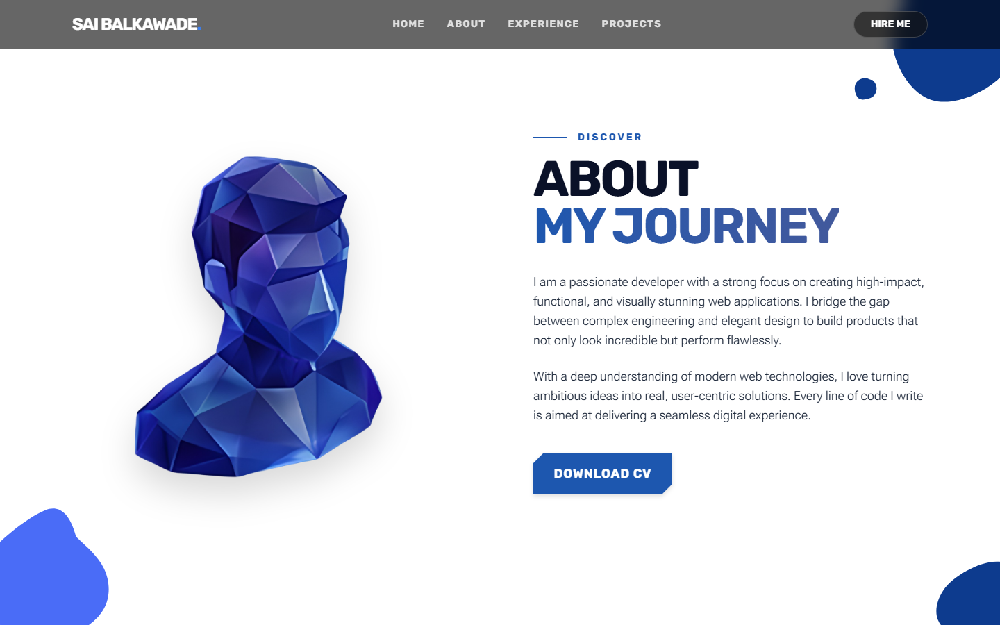
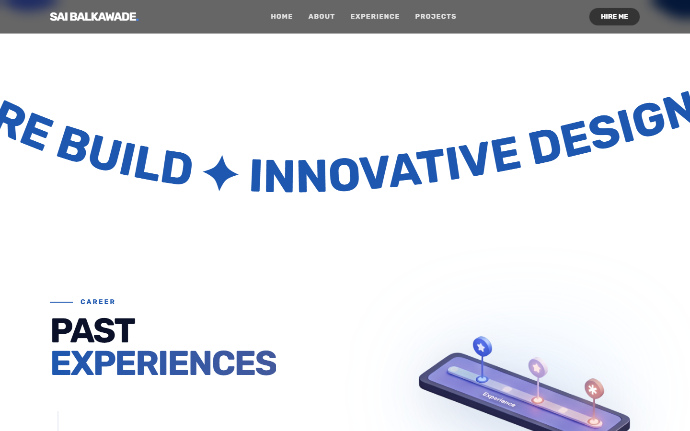
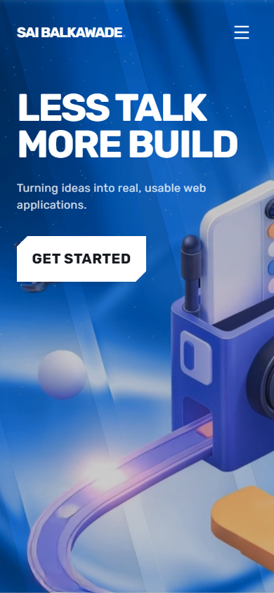

# Sai Balkawade | Portfolio

A fast, animated personal portfolio with a 3D hero, smooth scrolling and scroll-driven sections for About, Experience and Projects.

**Live demo: https://sai-folio.vercel.app/**

## Screenshots

**Home**


**About**



**Experience**



**Mobile view**



## Tech stack

- React 19 + TypeScript + Vite
- Tailwind CSS 4
- Three.js with React Three Fiber and drei (3D hero)
- GSAP, Framer Motion and Lenis (animation and smooth scroll)

## Run locally

```bash
npm install
npm run dev
```

Build for production with `npm run build`.
