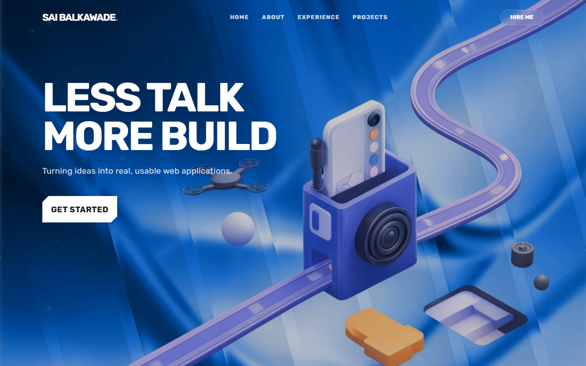

<div align="center">


# Sai Balkawade | Portfolio

**Animated developer portfolio with a 3D hero and smooth scrolling.**

<a href="https://sai-folio.vercel.app"></a>

<br/>



</div>

## Tech stack

- React 19 + TypeScript + Vite
- Tailwind CSS 4
- Three.js with React Three Fiber and drei (3D hero)
- GSAP, Framer Motion and Lenis (animation and smooth scroll)

## Run locally

```bash
npm install
npm run dev
```

Build for production with `npm run build`.
